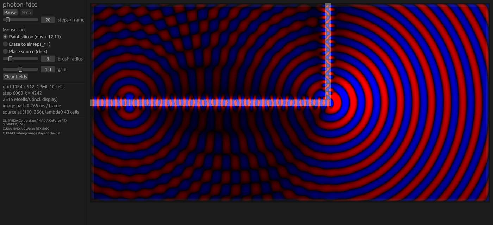
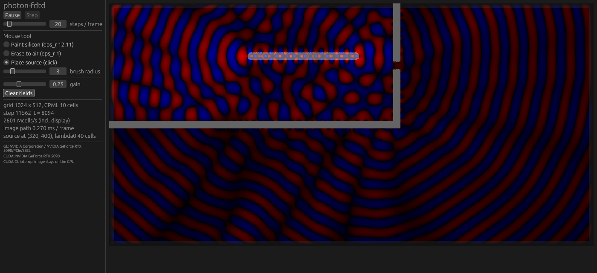

# photon-fdtd

photon-fdtd is a minimal 2D TM_z Yee FDTD solver in Rust. It has a CPU backend (one thread or a rayon thread pool) and a CUDA backend for the RTX 5090 (sm_120). Both backends use flat, row-major `Vec<f64>` arrays and natural units (c = eps0 = mu0 = dx = 1). The two backends give bitwise identical fields.

A CFS-CPML (Roden and Gedney, 2000) absorbs the outgoing waves. Its auxiliary arrays exist only in the boundary strips. A mode source and DFT port monitors give calibrated S-parameters of waveguide devices. An optional interactive viewer (`--features gui`) shows the field live and lets you paint silicon with the mouse.

## Reproduce every claim

Run the verification suite:

	cargo test --release

Run the demonstration binaries:

	cargo run --release --bin waveguide                          # silicon strip confinement, GPU parity
	cargo run --release --bin waveguide -- --check-pml           # CPML reflection in dB against thickness
	cargo run --release --bin waveguide -- --check-pml --sweep   # CPML parameter sweep (160 profiles)
	cargo run --release --bin bench -- --cpu 2048,4096 --gpu 4096,8192
	cargo run --release --bin sparams                            # slab mode, straight guide and 90-degree bend S-parameters
	cargo run --release --features gui --bin viewer                # interactive viewer
	cargo run --release --features gui --bin viewer -- --script examples/viewer_demo.script

The GPU tests and the binaries need CUDA device 0. They compile the kernels for `sm_120` at run time with NVRTC.

## Status by claim

The CPML and throughput results come from commit `921ccb35809a5872e2981425fb169f3d2dd35507`. The viewer results come from commit `d6e23e8c9a3528007c2c537044ffc191b51796b5`. The S-parameter results and the current test run come from commit `702b85c4f3eb6df12fb90a400267d46e03953548`. The solver kernels did not change after 921ccb3. All runs used the machine in [Environment](#environment). The raw output of each run is in `docs/results/`.

| Capability | Status | Evidence (entry point) |
|---|---|---|
| CFL enforcement (S <= 1/sqrt(2)) | Verified | `cfl_guard_rejects_courant_above_2d_limit` |
| 2D TM_z Yee update | Partial. The update is self-consistent and gives the expected physics. There is no comparison with an analytic solution. | `confinement_and_parity_*`, docs/methodology.md |
| Silicon strip confinement (eps_r = 12.11 in air) | Verified on 1200 x 600 and 600 x 1200 | `confinement_and_parity_1200x600`, `confinement_and_parity_600x1200`, `waveguide` |
| CPU serial, CPU rayon and GPU bit parity, with the CPML strips and corners | Verified, 0 differing bits | `bit_parity_cpml_corner_non_square_300x170`, `bit_parity_serial_parallel_gpu_512x256`, `confinement_and_parity_*` |
| CPML reflection at normal incidence and at the corner (10 cells) | Verified: -87.7 dB or lower for both pulses. Gates: -60 dB (normal) and -50 dB (corner). | `absorber_reflection_db`, `waveguide --check-pml` |
| CPML reflection at grazing incidence, about 81 degrees (10 cells) | Verified: -66.8 dB or lower. Gate: -50 dB. | `absorber_reflection_grazing_db` |
| The reflection metric detects a reflection | Verified: bare PEC walls give -0.2 dB (normal) and +4.9 dB (corner) | `absorber_metric_detects_bare_pec` |
| GPU byte offsets above 2^31 | Verified on 16384 x 20000 (2.62 GB per array) | `large_grid_16384x20000_gpu_corners_match_cpu` |
| GPU rows above the CUDA gridDim.y limit (65535) | Verified on 64 x 70000 | `tall_grid_past_cuda_grid_y_limit_matches_cpu` |
| Throughput (Mcells/s) | Measured | `bench`, docs/architecture.md |
| Viewer kernels: brush, heat map orientation and colours, field reset | Verified without a display | `gpu_viewer_kernels_paint_render_reset` |
| Viewer controls through egui (run, pause, step, brush, erase, source, gain, clear) | Verified by scripted pointer events, log and screenshots | `viewer --script examples/viewer_demo.script` |
| Viewer image path: CUDA-GL interop with the image on the GPU | Verified on the RTX 5090 (GL renderer NVIDIA) | `docs/results/viewer_paths.log` |
| Viewer input from a pointer device on KDE Plasma Wayland | Verified with a uinput virtual mouse (ydotool) through libinput, KWin and the native Wayland window: brush, erase, source, Pause and Run | `docs/results/viewer_real_mouse.log`, `docs/images/viewer_real_mouse.png` |
| Slab mode: measured beta vs grid eigenvalue vs analytic root | Verified: measured = grid within 8.3e-5; analytic - grid gap 7.7e-4 to 1.7e-3, 4.0x smaller at 2x resolution | `slab_mode_grid_dispersion_is_second_order`, `straight_guide_mode_energy_balance_and_cpml_reflection`, docs/sparams.md |
| Guided mode into the 10-cell CPML | Verified: modal back-reflection -83.4 dB or lower (alpha_max = 0.01) | `straight_guide_mode_energy_balance_and_cpml_reflection` |
| Straight guide energy balance | Verified: modal |S11|^2 + |S21|^2 = 1 within 4.3e-6, flux within 9.3e-4 | `straight_guide_mode_energy_balance_and_cpml_reflection` |
| Sharp 90-degree bend benchmark (lambda0 = 146 cells) | Measured: modal IL 3.748 dB, RL 6.69 dB, 36.4 % radiated | `bend_90_baseline_insertion_and_return_loss` |
| Adjoint gradient of the modal bend transmission (2D TMz) | Verified against finite differences: per cell, directional (4 step sizes) and full chain, ratio within 1e-4 | `adjoint_gradient_matches_finite_differences` |
| Inverse-designed bend, 48 x 48 box (2D TMz) | Verified under docs/stage5-protocol.md: worst IL 0.2586 dB, worst RL 23.36 dB (61 freqs); 0.33 dB better than the best conventional baseline, U = 0.0073 dB | `stage5_optimised_design_meets_gates`, docs/inverse-design.md |
| CPML absorption of evanescent waves | Open. Not measured. | none |
| Device selection, multi-GPU | Open. Device 0 is hard-coded. | none |

Test suite result at commit 702b85c: 14 tests pass, 0 fail, 0 are ignored. The test binary ran for 11.5 s. `cargo test --release` does not build the GUI dependencies.

## CPML thickness

The default profile is m = 3, sigma_max = 0.8 (m + 1) = 3.2, kappa_max = 1, alpha_max = 0.05 and m_alpha = 1. The scenarios use N = 10 cells. The table gives the reflection in dB (time-domain maximum), from `docs/results/check_pml.log`:

| N (cells) | Normal, A | Normal, B | Corner, A | Corner, B | Grazing, A | Grazing, B |
|---|---|---|---|---|---|---|
| 0 (bare PEC) | -0.2 | 1.3 | 4.9 | 7.0 | -0.0 | -0.0 |
| 4 | -43.0 | -44.0 | -38.3 | -38.7 | -23.0 | -22.5 |
| 6 | -65.7 | -63.3 | -61.6 | -61.0 | -36.9 | -37.5 |
| 8 | -81.1 | -82.0 | -80.2 | -76.9 | -56.2 | -52.4 |
| 10 | -90.5 | -88.4 | -89.9 | -87.7 | -70.2 | -66.8 |
| 12 | -96.0 | -95.5 | -93.5 | -92.1 | -80.7 | -80.2 |
| 16 | -102.9 | -102.6 | -100.2 | -100.9 | -103.9 | -109.3 |

Pulse A is a Gaussian-modulated sine (lambda0 = 40 cells, t0 = 90, tau = 30). Pulse B is a differentiated Gaussian with no DC content (tau = 9.00, t0 = 45.02).

- N = 6 is the thinnest PML that meets -60 dB at normal incidence and -50 dB at the corner for both pulses.
- N = 8 is the thinnest PML that also meets -50 dB at grazing incidence.

The parameter sweep does not agree with the usual advice of kappa_max = 5 to 11. At N = 10, kappa_max = 7 changes the grazing reflection from -66.8 dB to -40.2 dB. docs/verification.md gives the data and a hypothesis.

## Verified numbers

These are the results of the waveguide run. The grid is 1200 x 600 with a 10-cell CPML and S = 0.700036 (0.99 x 1/sqrt(2)). The run has 2572 steps (t = 1800). The strip occupies rows 292..308 (16 cells). The source is a soft line source at x = 100 across the strip: a Gaussian-modulated sine with lambda0 = 40 cells, t0 = 300 and tau = 80.

| Metric | Silicon strip | All-air control |
|---|---|---|
| Grid energy in rows 284..316 at t_end | 0.9999 | 0.0545 |
| Time-integrated Ez^2 in rows 284..316 at x = 400 | 0.9933 | 0.0677 |
| RMS transverse width at x = 400 | 17.9 cells | 155.8 cells |
| Grid energy at t_end / peak grid energy | 0.496 | 6.44e-11 |
| GPU vs CPU serial, differing Ez values | 0 of 720000 | not run |

In the silicon run, the pulse centre on the axis is at x = 507 at t_end. The pulse moves at a group velocity of about 0.271 c, so n_g is about 3.69.

These are the throughput results, f64, median of 3 trials (from `docs/results/bench.log`):

| Backend | Grid | Mcells/s | Effective GB/s (80 B/cell) |
|---|---|---|---|
| CPU, 1 thread | 4104^2 | 438.5 | 35 |
| CPU, 1 thread | 4096^2 | 225.4 | 18 |
| CPU, rayon 24 threads | 4096^2 | 622.8 | 50 |
| RTX 5090 | 4096^2 | 15561.7 | 1245 |
| RTX 5090 | 8192^2 | 15621.1 | 1250 |
| RTX 5090 | 16384^2 | 15654.2 | 1252 |

One cell update is one H update plus one E update of one cell, with the CPML strips. Desktop processes shared the GPU during the benchmark (kwin_wayland, gamescope, Chrome, Discord, a MetaBonk viewer and the CUDA MPS server).

v0.1.0 used a conductive sponge. At 4096^2, it gave 12959.7 Mcells/s on the GPU and 498.1 Mcells/s on 24 CPU threads. The CPML removed the per-cell loss coefficients, so the minimum traffic decreased from 104 to 80 bytes per cell.

## Interactive viewer

	cargo run --release --features gui --bin viewer

The core library has no GUI dependencies. Only the `viewer` binary uses eframe (egui with the glow OpenGL backend), and only with `--features gui`. The viewer opens a 1024 x 512 grid with a 10-cell CPML and a silicon strip that bends 90 degrees. A continuous-wave line source (lambda0 = 40 cells) drives the strip.

The viewer has four groups of controls:

- **Pause** or **Run**, **Step**, and a steps-per-frame slider.
- The mouse tool: **Paint silicon** (eps_r 12.11) and **Erase to air** (eps_r 1) with a brush radius. A drag paints from the press point and fills the segments between frames.
- **Place source**: click a cell to move the line source there.
- **gain** for the heat map, and **Clear fields**. Red is +Ez and blue is -Ez. Silicon is grey.

Each frame, the `render_rgba` CUDA kernel writes the image into an OpenGL pixel buffer that CUDA has mapped with `cuGraphicsGLRegisterBuffer`. OpenGL copies the buffer into the texture. Thus the field never goes to the host. If the registration fails, the viewer copies the 2 MiB RGBA image through the host and shows that path in the panel. From `docs/results/viewer_paths.log`:

| Image path | Image time per frame |
|---|---|
| CUDA-GL interop | 0.266 ms |
| Host copy (`--host-copy`) | 0.590 ms |

The image time includes the render kernel, the texture update and `glFinish`. The display runs at 239.96 Hz. With 20 steps per frame, the viewer gives 2510 Mcells/s, which is 239 frames/s. Thus the display rate limits the viewer, not the image path.

`--script FILE` replays pointer input as egui events, so scripted input goes through the same widgets and hit tests as a mouse. `examples/viewer_demo.script` uses every control and saves two screenshots. `docs/results/viewer_demo.log` has its output. F12 saves a screenshot at any time.

## Environment

- CPU: AMD Ryzen 9 7900X, 12 cores, 24 threads. 32 MiB L3 per CCD, 2 CCDs.
- RAM: 31.9 GB, DDR5 at 6000 MT/s, 2 modules.
- GPU: NVIDIA GeForce RTX 5090, 32 GB, driver 615.78.08, CUDA 13.1 (NVRTC).
- OS: Fedora, Linux 7.2.12-200.fc44.x86_64.
- Rust: rustc 1.96.0. Release profile with `lto = "fat"`, `codegen-units = 1` and `-C target-cpu=native`.

## Limits that are not verified

- The suite does not run CPU grids larger than 4104^2. Host RAM (31.9 GB) limits the CPU solver.
- No test crosses 2^32 bytes per array. The largest test array is 2.62 GB.
- The GPU backend uses CUDA device 0 only. The kernels compile for `sm_120` only.
- The CPML is measured for propagating waves in air at three probe cells, and for the guided slab mode at normal incidence. Evanescent waves are not measured.
- The CPML default alpha_max = 0.05 removes absorption for omega < 0.05 (lambda0 > 126 cells). The S-parameter setup uses alpha_max = 0.01. docs/sparams.md has the data.
- The S-parameters are power ratios of the fundamental mode, without phase. Only the straight guide and one sharp bend are measured.
- No test compares the numerical dispersion with the analytic Yee dispersion relation.
- The pointer test used a uinput virtual mouse, not a human hand on a physical mouse. The kernel, libinput, KWin and Wayland path is the same. The hardware is not.
- In the air control, the band-energy fraction at t_end is a ratio of residual energies near 6e-11 of the peak. For the air control, the probe metric is the reliable metric.

## Documentation

- [docs/methodology.md](docs/methodology.md): the discrete equations, the CFL derivation, the CPML and the sources.
- [docs/verification.md](docs/verification.md): what each test does, how the reflection is measured, and the parameter sweep.
- [docs/inverse-design.md](docs/inverse-design.md): the Stage 5 design region, the baselines and the proposed gates (work in progress).
- [docs/sparams.md](docs/sparams.md): the slab mode, the mode source, the ports, the S-parameters and the bend benchmark.
- [docs/architecture.md](docs/architecture.md): the memory layout, the strip layout, the CUDA mapping, the viewer boundary and the throughput analysis.
